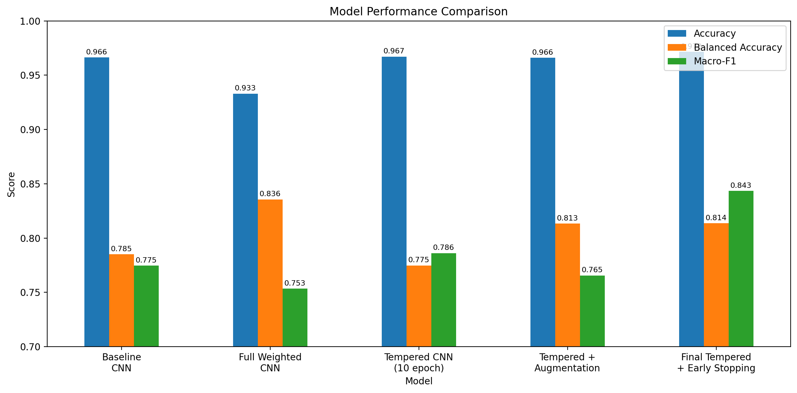
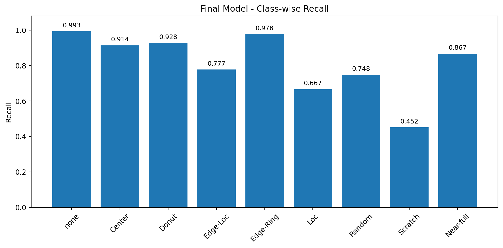
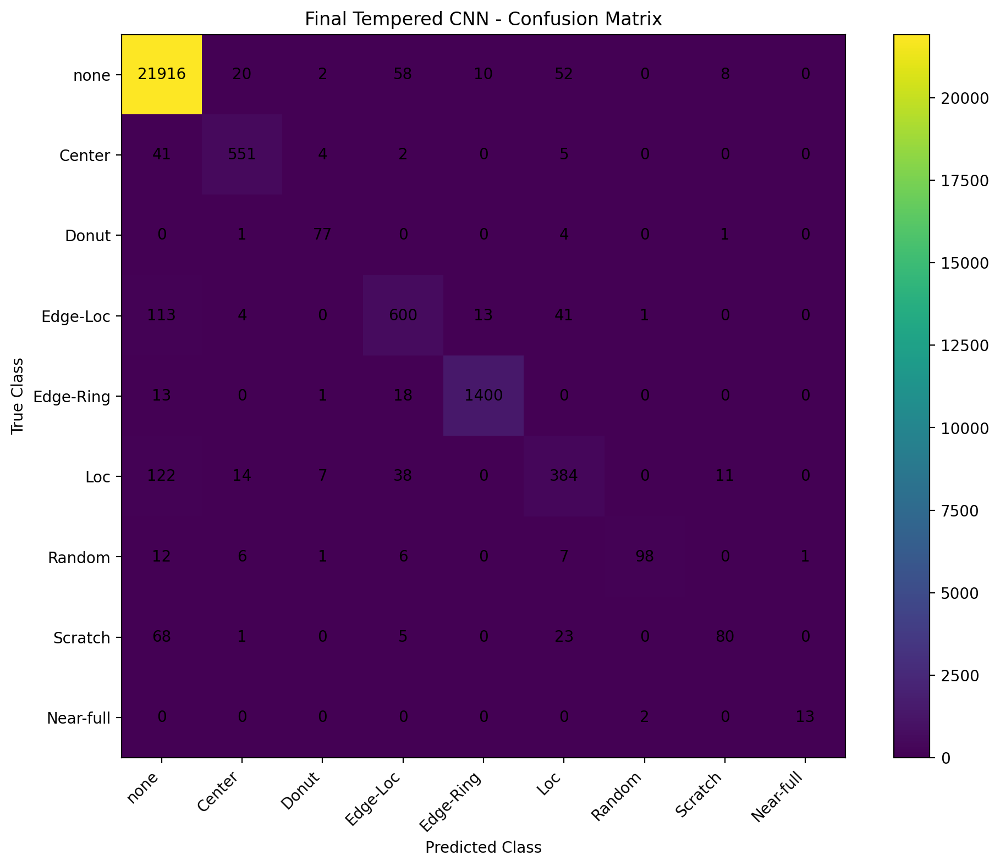
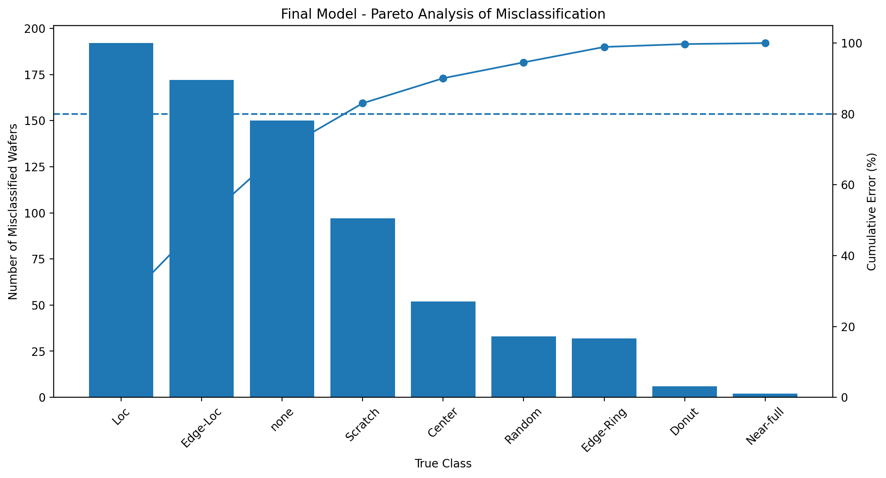

# WM-811K Wafer Map Defect Classification

> **Lot-aware split · Class imbalance experiments · Grad-CAM · Pareto error analysis · Early stopping**

WM-811K wafer map 데이터를 이용해 9개 패턴을 분류하고, 단순 Accuracy보다 **데이터 누수 방지, 불균형 대응, minority-class 성능, 모델 실패 구조**를 중심으로 분석한 프로젝트입니다.

[🚀 Live Demo](https://wafer-map-defect-classification-hosszcsr97joayh8brtf4n.streamlit.app/) · [📓 Full Experiment Notebook](notebooks/wafer_project.ipynb)

## Key Results

| Model | Accuracy | Balanced Accuracy | Macro-F1 |
|---|---:|---:|---:|
| Baseline CNN | 0.9663 | 0.7851 | 0.7745 |
| Full Weighted CNN | 0.9330 | **0.8356** | 0.7534 |
| Tempered CNN (10 epoch) | 0.9670 | 0.7748 | 0.7861 |
| Tempered + Augmentation | 0.9660 | 0.8133 | 0.7655 |
| **Final Tempered + Early Stopping** | **0.9715** | 0.8137 | **0.8434** |

**Final model**
- Simple CNN + `sqrt(balanced class weight)`
- Best epoch: **24**
- Test Accuracy: **97.15%**
- Balanced Accuracy: **81.37%**
- Macro-F1: **84.34%**
- Scratch Recall: **45.20%**



---

## Why This Project?

WM-811K는 정상(`none`) class가 labeled data의 약 **85.25%**를 차지하는 강한 불균형 데이터입니다.

Baseline CNN은 Test Accuracy **96.63%**를 기록했지만 Scratch Recall은 **3.95%**에 불과했습니다. 즉 높은 Accuracy만으로는 minority defect class의 실제 분류 성능을 판단하기 어렵다는 문제가 있었습니다.

이 프로젝트에서는 다음 질문을 순서대로 검증했습니다.

1. 같은 생산 lot이 Train/Test에 섞이는 데이터 누수를 어떻게 막을 것인가?
2. 심한 class imbalance를 어떤 방식으로 완화할 것인가?
3. minority recall을 높이면서 전체 Macro-F1을 유지할 수 있는가?
4. 모델이 어떤 공간 영역을 보고 판단하는가?
5. 최종 모델의 오류는 어떤 class와 confusion pair에 집중되는가?

---

## Dataset

**WM-811K Wafer Map Dataset**

원본 `LSWMD.pkl` 기준:

| Item | Value |
|---|---:|
| Total wafers | 811,457 |
| Labeled wafers | 172,950 |
| Unlabeled wafers | 638,507 |
| Unique lots | 46,293 |
| Classes | 9 |

사용한 9개 class:

`none`, `Center`, `Donut`, `Edge-Loc`, `Edge-Ring`, `Loc`, `Random`, `Scratch`, `Near-full`

원본 데이터에서는 `failureType`이 ndarray 형태로 저장되어 있어 label 정제가 필요합니다.

특히 아래 두 값은 서로 다릅니다.

- Python `None`: unlabeled wafer
- 문자열 `"none"`: 정상 wafer class

또한 원본 컬럼명이 `trainTestLabel`이 아니라 실제로는 `trianTestLabel`로 저장되어 있습니다.

---

## Preprocessing

Wafer map 크기가 서로 달라 CNN batch 입력을 위해 **64×64**로 통일했습니다.

- Resize: `cv2.INTER_NEAREST`
- Input shape: `1 × 64 × 64`
- Original pixel values: `0 / 1 / 2`
- Normalized values: `0.0 / 0.5 / 1.0`

Wafer map은 일반 RGB 이미지가 아니라 die 상태를 나타내는 범주형 grid이므로 bilinear interpolation 대신 nearest-neighbor interpolation을 사용했습니다.

---

## Lot-aware Split

동일 생산 lot의 wafer가 Train과 Test에 동시에 포함되는 것을 막기 위해 `lotName`을 group으로 사용했습니다.

| Split | Samples | Ratio |
|---|---:|---:|
| Train | 120,979 | 69.95% |
| Validation | 26,116 | 15.10% |
| Test | 25,855 | 14.95% |

검증 결과:

```text
Train ∩ Validation = 0 lots
Train ∩ Test       = 0 lots
Validation ∩ Test  = 0 lots
```

단순 wafer-level random split보다 생산 단위 leakage 가능성을 줄이는 것을 우선했습니다.

---

## Model

Baseline과 모든 비교 실험에서 동일한 Simple CNN 구조를 사용했습니다.

```text
Input 1×64×64
  ↓
Conv2D(32) + BatchNorm + ReLU + MaxPool
  ↓
Conv2D(64) + BatchNorm + ReLU + MaxPool
  ↓
Conv2D(128) + BatchNorm + ReLU + MaxPool
  ↓
Flatten
  ↓
Linear(256) + ReLU + Dropout
  ↓
Linear(9)
```

기본 optimizer는 Adam, learning rate는 `1e-3`, batch size는 `128`입니다.

---

## Experiment Flow

### 1. Baseline CNN

Class weighting 없이 학습했습니다.

- Accuracy: 0.9663
- Balanced Accuracy: 0.7851
- Macro-F1: 0.7745
- **Scratch Recall: 0.0395**

전체 Accuracy는 높았지만 Scratch를 거의 분류하지 못했습니다.

### 2. Full Balanced Class Weight

Train set 기준 balanced class weight를 적용했습니다.

가장 희소한 Near-full의 weight가 약 **125.6**까지 커졌습니다.

결과:
- Scratch Recall: **3.95% → 34.46%**
- Balanced Accuracy: **0.7851 → 0.8356**
- Accuracy: **0.9663 → 0.9330**
- Macro-F1: **0.7745 → 0.7534**

Minority recall은 개선됐지만 전체 성능 trade-off가 컸습니다.

### 3. Tempered Weight

극단적인 class weight를 완화하기 위해 다음을 적용했습니다.

```text
tempered_weight = sqrt(balanced_class_weight)
```

10-epoch 비교 실험에서:
- Accuracy: 0.9670
- Macro-F1: 0.7861
- Scratch Recall: 0.1977
- Loc Recall: 0.6649

Full weighting보다 안정적인 trade-off를 보였습니다.

### 4. Tempered Weight + Augmentation

Train set에만 90° rotation, horizontal flip, vertical flip을 적용했습니다.

- Balanced Accuracy: 0.8133
- Scratch Recall: 0.3333
- Macro-F1: 0.7655

Scratch recall은 증가했지만 Macro-F1은 감소했습니다. Wafer orientation 자체가 유용한 정보일 가능성이 있어 augmentation을 무조건 확대하지 않았습니다.

### 5. Final Training with Early Stopping

초기 실험은 모델 간 공정한 비교를 위해 10 epoch로 맞췄지만, 최종 모델에서는 10 epoch가 충분한지 다시 검증했습니다.

- Max epochs: 50
- Early-stopping patience: 7
- Selection metric: Validation Macro-F1
- Best epoch: **24**
- Early stopped at epoch: **31**
- Best Validation Macro-F1: **0.8412**

Epoch 10의 Validation Macro-F1은 약 **0.8201**, Epoch 24는 **0.8412**였습니다. 따라서 10 epoch는 초기 비교용으로는 적절했지만 최종 학습에는 충분하지 않았습니다.

---

## Final Model Performance

### Class-wise Recall



| Class | Recall |
|---|---:|
| none | 0.9932 |
| Center | 0.9138 |
| Donut | 0.9277 |
| Edge-Loc | 0.7772 |
| Edge-Ring | 0.9777 |
| Loc | 0.6667 |
| Random | 0.7481 |
| Scratch | **0.4520** |
| Near-full | 0.8667 |

Scratch는 여전히 가장 어려운 class지만, Recall은 다음과 같이 개선됐습니다.

```text
Baseline       3.95%
Tempered      19.77%
Final         45.20%
```

Near-full은 Test support가 15개뿐이므로 높은 recall을 강하게 일반화하지 않습니다.

---

## Confusion Matrix



최종 모델의 전체 Test error는 **736 / 25,855**입니다.

가장 큰 misclassification pair는:

```text
Loc → none      : 122
Edge-Loc → none : 113
Scratch → none  : 68
none → Edge-Loc : 58
none → Loc      : 52
```

최종 모델의 주요 limitation은 **local defect와 normal pattern 사이의 confusion**으로 정리할 수 있습니다.

---

## Pareto Error Analysis



| True class | Errors | Share |
|---|---:|---:|
| Loc | 192 | 26.09% |
| Edge-Loc | 172 | 23.37% |
| none | 150 | 20.38% |
| Scratch | 97 | 13.18% |

상위 네 class가 전체 오류의 **83.02%**를 차지했습니다.

따라서 모든 class를 동일하게 개선하기보다 `Loc / Edge-Loc / none / Scratch` 사이의 decision boundary를 우선적으로 개선하는 것이 더 효율적인 다음 단계입니다.

---

## Grad-CAM Analysis

Grad-CAM을 이용해 CNN이 wafer의 어느 공간 영역에 반응하는지 확인했습니다.

주요 관찰:
- **Center 정분류**: 실제 중앙 defect cluster와 주요 activation 영역이 대체로 일치
- **Scratch → none**: 특정 선형 defect에 집중되지 않고 activation이 분산된 사례 존재
- **Scratch → Loc**: 전체 scratch 구조보다 일부 local/boundary 영역에 집중된 사례 존재
- 일부 correctly classified Scratch에서 near-zero CAM이 나타나 interpretability의 한계도 확인

Grad-CAM은 **모델의 spatial relevance를 시각화하는 보조 도구**로 사용했으며, 이를 실제 반도체 공정의 물리적 root cause로 해석하지 않았습니다.

상세 실험과 debugging 과정은 notebook에 남겨 두었습니다.

---

## Key Findings

### 1. High Accuracy did not guarantee minority-class performance
Baseline Accuracy는 96.63%였지만 Scratch Recall은 3.95%였습니다.

### 2. Full weighting improved minority recall but over-corrected
Balanced Accuracy는 가장 높았지만 Accuracy와 Macro-F1이 하락했습니다.

### 3. Tempered weighting reduced the weighting trade-off
Square-root weighting으로 rare class를 강조하되 극단적인 penalty를 완화했습니다.

### 4. Longer training was necessary for the final model
Validation Macro-F1 기준 best epoch가 24였으며, 10 epoch에서 학습을 종료했다면 최종 성능 개선을 놓쳤습니다.

### 5. Final errors were concentrated in a small set of classes
`Loc + Edge-Loc + none + Scratch`가 전체 오류의 83.02%를 차지했습니다.

### 6. Explainability also had limitations
Grad-CAM은 일부 class에서는 의미 있는 영역을 보여줬지만 모든 sample에서 안정적이지 않았습니다.

---

## Limitations

- **Class imbalance**: Near-full 등 일부 class의 sample 수가 매우 적습니다.
- **Public dataset representativeness**: WM-811K의 class distribution을 실제 Fab의 defect 발생률로 해석할 수 없습니다.
- **Resize assumption**: 비정사각형 wafer를 64×64로 직접 resize했기 때문에 원래 aspect ratio가 변할 수 있습니다.
- **Augmentation assumption**: Rotation/flip 이후 label이 유지된다고 가정했지만 실제 제조 환경에서는 orientation이 의미 있는 정보일 수 있습니다.
- **Root-cause limitation**: wafer pattern과 실제 공정 root cause는 1:1 대응한다고 볼 수 없습니다.
- **Grad-CAM limitation**: spatial activation은 보여주지만 물리적 원인이나 모델의 완전한 reasoning을 설명하지 않습니다.
- **Rare-class uncertainty**: Near-full Test support는 15개로 통계적 변동성이 큽니다.

---

## Repository Structure

```text
wafer-map-defect-classification/
├── README.md
├── .gitignore
├── requirements.txt
├── streamlit_app.py
├── src/
│   ├── __init__.py
│   ├── config.py
│   ├── model.py
│   ├── preprocessing.py
│   ├── inference.py
│   ├── gradcam.py
│   └── visualization.py
├── notebooks/
│   └── wafer_project.ipynb
└── results/
    ├── final_model_comparison.csv
    ├── final_model_comparison.png
    ├── final_class_recall.png
    ├── final_confusion_matrix.csv
    ├── final_confusion_matrix.png
    ├── final_class_error_analysis.csv
    ├── final_error_pairs.csv
    ├── final_pareto_chart.png
    ├── final_pareto_class_errors.csv
    └── final_project_metrics.json
```

전체 실험 기록은 `notebooks/wafer_project.ipynb`에 정리되어 있습니다.

Streamlit 코드는 UI와 핵심 로직을 분리하여 `src/` 모듈 구조로 정리했습니다.

---

## Project Workflow

```text
WM-811K
   ↓
Dataset inspection / label cleaning
   ↓
172,950 labeled wafers
   ↓
EDA + 64×64 preprocessing
   ↓
Lot-aware Train / Validation / Test split
   ↓
Baseline CNN
   ↓
Full balanced weighting
   ↓
Tempered weighting
   ↓
Tempered + augmentation
   ↓
Grad-CAM / error analysis
   ↓
Final training + early stopping
   ↓
Final confusion / Pareto analysis
   ↓
Result packaging
```

---

## Streamlit Demo

**Live app:** https://wafer-map-defect-classification-hosszcsr97joayh8brtf4n.streamlit.app/

프로젝트의 전처리 → 예측 → class probability → Grad-CAM 흐름을 직접 확인할 수 있는 Streamlit demo를 추가했습니다.

```bash
pip install -r requirements.txt
streamlit run streamlit_app.py
```

Demo 기능:

- `.npy` / `.csv` wafer map 업로드
- PNG/JPG 입력 지원(시각 데모용 approximate conversion)
- 64×64 nearest-neighbor preprocessing
- 9-class prediction
- class probability bar chart
- Grad-CAM visualization
- synthetic Center / Edge-Ring / Loc / Scratch sample
- GitHub Release의 검증된 final checkpoint 자동 다운로드
- 자동 다운로드 실패 시 sidebar checkpoint 업로드 fallback

학습된 checkpoint는 일반 repository 파일로 commit하지 않고 **GitHub Release asset**으로 분리했습니다.

- Release: `v1.0.0`
- Asset: `final_tempered_cnn_earlystop.pt`
- Streamlit 앱은 실행 시 checkpoint를 자동 다운로드하고 SHA-256을 검증합니다.
- 자동 다운로드가 실패할 때만 sidebar의 checkpoint uploader를 fallback으로 사용할 수 있습니다.

> Synthetic sample은 UI와 inference pipeline 동작 확인용이며, WM-811K test performance 평가용 데이터가 아닙니다.


---

## Reproducibility

원본 WM-811K 데이터와 학습 checkpoint는 repository에 포함하지 않습니다.

제외 대상:
- `LSWMD.pkl`
- processed split `.pkl` files
- model `.pt` checkpoints

실험의 전처리, lot-aware split, CNN 학습, weighting, Grad-CAM, error analysis 과정은 notebook에서 확인할 수 있습니다.

---

## Result Files

정량 결과는 `results/`에 CSV/JSON으로 저장되어 있습니다.

- `final_model_comparison.csv`
- `final_class_error_analysis.csv`
- `final_error_pairs.csv`
- `final_pareto_class_errors.csv`
- `final_confusion_matrix.csv`
- `final_project_metrics.json`

이를 통해 README의 최종 수치를 별도로 검증할 수 있습니다.

---

## Future Work

현재 성능을 무작정 더 높이기보다 확인된 failure mode를 기준으로 다음 개선을 고려할 수 있습니다.

- `Loc / Edge-Loc / none` 구분 개선
- Scratch-specific feature learning
- direct resize와 aspect-ratio-preserving preprocessing의 비교
- Grad-CAM++ 등 추가 explainability 비교
- repeated/group cross-validation을 통한 rare-class 안정성 확인
- 실제 WM-811K 샘플 기반 demo example 추가
- Streamlit cold-start와 model caching 최적화

---

## Project Status

- Dataset inspection ✅
- EDA / preprocessing ✅
- Lot-aware split ✅
- Baseline CNN ✅
- Class weighting experiments ✅
- Augmentation experiment ✅
- Grad-CAM ✅
- Pareto / detailed error analysis ✅
- Final early-stopping training ✅
- Final result packaging ✅
- README cleanup ✅
- Streamlit inference demo ✅
- Streamlit Community Cloud deployment ✅
- GitHub Release checkpoint auto-loading ✅

---

### Summary

이 프로젝트는 단순히 높은 wafer-map classification Accuracy를 얻는 것보다,

**lot leakage 방지 → class imbalance 문제 발견 → weighting/augmentation 비교 → explainability → error Pareto 분석 → validation-based final model selection**

이라는 실험 흐름을 구축하는 데 초점을 두었습니다.

최종 모델은 **Accuracy 97.15%, Macro-F1 84.34%**를 기록했으며, 이후 개선 대상도 전체 모델 복잡도 증가가 아니라 **local defect와 normal wafer 사이의 주요 confusion region**으로 구체화했습니다.
